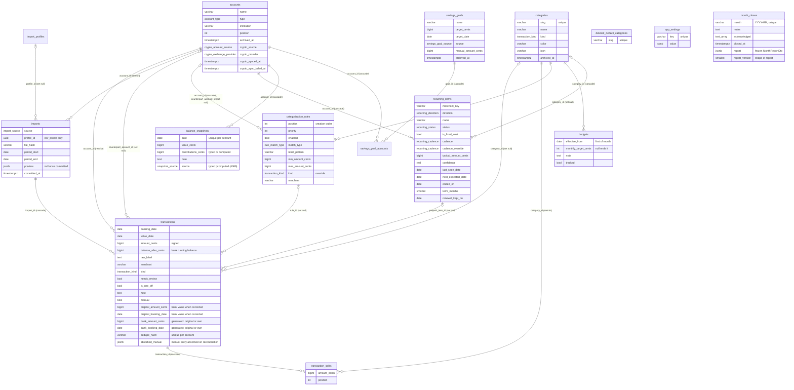
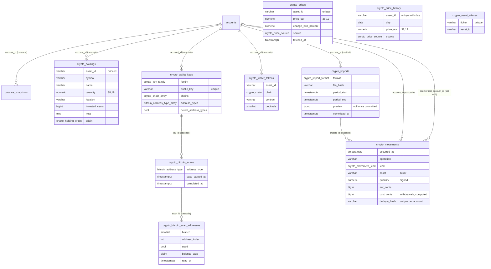
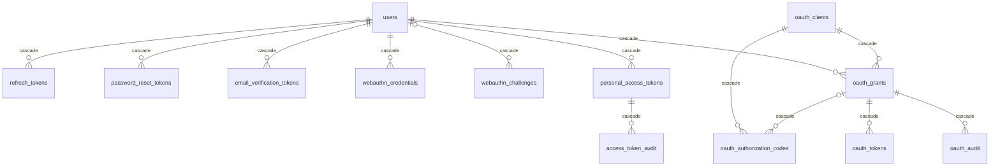

# Data model

Audit of the PostgreSQL model against the product's needs (#362, 20/11/2026). It describes the model as it is on `main` after migration `0034_prepaid_subscriptions`, maps the needs onto it and ranks what strains. The target model and the migration path are in [ADR 0005](../adr/0005-data-model-consolidation.md).

**Since the audit.** #367 (R3, R4, R7, migration `0039_db_hygiene`) moved the rules marked « code » below into check constraints, added the generated bank columns and their index, and turned every time stamp into `timestamptz` with `updated_at` kept by a trigger; this document marks those places « DB (#367) ».

Since written: R2 was built by #370 with #373 (the cost follows the coins); the tables below describe the model before it unless they say so. Open work taken into account: #357 (split part's kind, PR #363: the view reads a part's category kind, no column), #358 (crypto invested base, in progress: `accounts.invested_base_cents` / `invested_base_on`), #359 (contacts, money owed to the owner, prototypes in PR #361), #360 (one set of investment figures, prototypes).

**How it was checked.** Schemas (`apps/api/src/**/*.schema.ts`), the 35 migrations (`apps/api/drizzle/0000` → `0034`) and the services that enforce the rules. Queries were run on a throwaway database seeded with `pnpm db:demo --reset` (synthetic data only), then on a ×20 synthetic copy of its transactions (15 300 rows, several times the owner's volume) for the query plans. No production data was read.

## 1. What the app manages

| Concept                                      | Where it lives                                                                                                                                                                                                            | Invariants, and who enforces them                                                                                                                                                                                     |
| -------------------------------------------- | ------------------------------------------------------------------------------------------------------------------------------------------------------------------------------------------------------------------------- | --------------------------------------------------------------------------------------------------------------------------------------------------------------------------------------------------------------------- |
| **Money moved**: bank rows                   | `transactions` (`import_id` set, `manual = false`), `imports`                                                                                                                                                             | dedupe hash unique per account (DB); `manual` ⇔ no import ⇔ `manual:` hash (DB, #367); bank values kept when corrected (`original_*`, code; read through `bank_*`, DB) ; continuity with `balance_after_cents` (code) |
| Manual entries                               | `transactions` (`manual = true`, `import_id` null, `manual:<uuid>` hash)                                                                                                                                                  | never in the future, meal-voucher daily cap, replaced by the matching bank row (code)                                                                                                                                 |
| Transfers                                    | `transactions.kind = 'transfer'` + `counterpart_account_id`; `crypto_movements.counterpart_account_id`                                                                                                                    | never income or expense (code, everywhere); counterpart ≠ own account (DB); counterpart only on transfers (DB, #367)                                                                                                  |
| Refunds                                      | an `expense` row with a positive amount in an expense category                                                                                                                                                            | reduces the category's spending (code: budgets, spending)                                                                                                                                                             |
| Splits                                       | `transaction_splits` + the `transaction_lines` view                                                                                                                                                                       | 2–20 parts, same sign, sum = amount (code); largest part's category copied on the transaction (code)                                                                                                                  |
| Shares owed by others (#359)                 | not modelled yet (filed as income in « Remboursements »)                                                                                                                                                                  | —                                                                                                                                                                                                                     |
| **Classification**: category                 | `transactions.category_id`, `transaction_splits.category_id`, `categories`                                                                                                                                                | category kind fixed once used (code)                                                                                                                                                                                  |
| Kind                                         | `categories.kind`; `transactions.kind` its copy on a categorized row (#368), free only without a category; a line's kind is its category's                                                                                | trigger `transactions_kind_follows_category` keeps the copy equal (DB, #368); `transaction_lines.kind = coalesce(category kind, t.kind)`                                                                              |
| One-off, review, note                        | `transactions.is_one_off`, `needs_review`, `note`; prepaid payments count as one-off in the view                                                                                                                          | uncategorized ⇒ in review (code)                                                                                                                                                                                      |
| Rules                                        | `categorization_rules`                                                                                                                                                                                                    | computed order: `priority`, specificity, `position` (code)                                                                                                                                                            |
| **Value held**: cash balance                 | computed from `transactions` (bank values) anchored on `balance_after_cents` or a `balance_snapshots` row                                                                                                                 | code (`AccountsService.loadBalances`)                                                                                                                                                                                 |
| Investment value                             | `balance_snapshots.value_cents`, one per account and day (DB unique)                                                                                                                                                      | crypto: one `computed` point per day, written by the daily close (#366); `source` checked by a trigger                                                                                                                |
| Crypto holdings                              | `crypto_holdings` (origins `import`, `sync`, `manual`)                                                                                                                                                                    | each origin replaced only by its own writer (code); quantity ≥ 0 (DB)                                                                                                                                                 |
| Invested amount                              | `balance_snapshots.contributions_cents` (typed or computed), linked transfers (`transactions.counterpart_account_id`), `crypto_holdings.invested_cents`, `crypto_movements.cost_cents`, `accounts.invested_base_*` (#358) | merged by `investments/performance.ts` and `crypto/valuation.ts` (code)                                                                                                                                               |
| **Plans**: budgets and planned income        | `budgets` (effective-dated, carried over)                                                                                                                                                                                 | first of month, target > 0 (DB); transfer categories refused, income never tracked (code)                                                                                                                             |
| Envelopes                                    | `budgets.tracked`                                                                                                                                                                                                         | code                                                                                                                                                                                                                  |
| Savings goals and target                     | `savings_goals`, `savings_goal_accounts`, `app_settings` (`savings.monthly_target_cents`)                                                                                                                                 | target > 0 (DB)                                                                                                                                                                                                       |
| Recurring items, prepaid plans, cancellation | `recurring_items` (+ `transactions.prepaid_item_id`)                                                                                                                                                                      | detection never overwrites the owner's columns (code); term 2–60, debits only, `ended_on` on confirmed only (DB)                                                                                                      |
| Forecast, coverage                           | computed only (`forecast/`, `coverage/`)                                                                                                                                                                                  | —                                                                                                                                                                                                                     |
| **Closings**: month close                    | `month_closes` (`report` jsonb frozen at the close, `report_version`)                                                                                                                                                     | closed ⇔ report ⇔ report version (DB); ticks only on `recurring`, `budget`, `savings` (DB, #367)                                                                                                                      |
| **Access** (not finance)                     | `users`, sessions, passkeys, tokens, OAuth                                                                                                                                                                                | see their ADRs                                                                                                                                                                                                        |

## 2. Entity-relationship diagrams

Columns shown are the ones that carry meaning; every table also has `id` (uuid), `created_at` and `updated_at` (`coreColumns`, `timestamptz`; `updated_at` kept by the `set_updated_at()` trigger, #367).

### Ledger, classification and plans

`transaction_lines` (view): one row per transaction, or one per split part (`split_id`, the part's category and amount, everything else from the transaction); `is_one_off` is also true for prepaid payments. Read by spending, budgets, envelopes, month close, savings flows, categories usage and the transaction totals.

### Investments and crypto

`crypto_prices` and `crypto_asset_aliases` are keyed by asset id or ticker, with no foreign key: they are shared by every account.

### Access (single owner)

These 13 tables are covered by [`docs/domain/auth-and-sessions.md`](../domain/auth-and-sessions.md) (Auth, Passkeys, Personal access tokens) and ADR 0003; the audit found nothing to change in them beyond the hygiene points of § 6 (time zones).

## 3. Tables

36 tables and one view. « DB » = enforced by a constraint; « code » = enforced only by the services.

### Ledger

- **`accounts`** — the owner's accounts, seven types. Crypto columns: `crypto_source` iff `type = 'crypto'` (DB), `crypto_provider` iff source `exchange` (DB); `crypto_synced_at` / `crypto_sync_failed_at` only on crypto accounts (DB, #367). Archive rather than delete; delete is one DB transaction across every dependant (code, `DELETE /api/accounts/:id`).
- **`transactions`** — bank rows, manual entries and the spreadsheet history in one table. Unique `(account_id, dedupe_hash)` (DB). Counterpart ≠ own account (DB). Since #367 (DB): counterpart only on transfers, prepaid link only on expenses, `manual` ⇔ no import ⇔ `manual:` hash, corrections only on bank rows (`original_*` never on manual rows); since #398 a bank row's amount and date never change but back to the bank's (`transactions_bank_values_kept` trigger), so `original_*` only remain on rows corrected before; `bank_amount_cents` / `bank_booking_date` are generated stored columns (the original of a corrected row, else its own), read by every reader of bank data, with the partial index `(account_id, bank_booking_date) where not manual`; a partial index on `needs_review`. Code only: uncategorized ⇒ `needs_review`, `kind` agrees with the category.
- **`transaction_splits`** — parts of a split transaction. Unique `(transaction_id, position)` (DB). Code only: 2–20 parts, same sign as the transaction, never 0, sum = amount, the transaction's category = largest part's, its amount locked while split, a whole-transaction category ends the split.
- **`imports`** — one uploaded bank file (CIC CSV, standard CSV, or a CSV read through an import profile, #431) or one account's share of the spreadsheet history. `profile_id` only on `csv_profile` imports (check `imports_profile_source`), set to null when the profile is deleted. `preview` jsonb while pending, null once committed (code). Accounts restrict their deletion (the account deletion deletes them first). Undoing deletes its transactions (code, plus `ON DELETE CASCADE`), after putting back as manual transactions the ones its rows absorbed on reconciliation (`transactions.absorbed_manual`: their day, typed label and own note; only on bank rows, check constraint; #371). `GET /api/imports/:id` counts beforehand the rows edited by hand and the absorbed entries (`imports/undo/`).

### Classification

- **`categories`** — slug unique (DB); kind, colour, icon (one of `CATEGORY_ICONS`, code); archived categories leave the pickers. Code only: kind frozen once used, name unique, deleting one moves its usage to a category of the same kind.
- **`deleted_default_categories`** — tombstones so the seed never re-creates a default category the owner deleted.
- **`categorization_rules`** — conditions (contains / regex, account, amount bounds) and outcome (category, whose kind it gives since #368, merchant, counterpart account). Order computed from `priority`, specificity, then `position` (creation order). Code only: counterpart only when the outcome is a transfer.

### Plans and closings

- **`budgets`** — effective-dated monthly targets per category (expense targets and planned income, #315): first of month and target > 0 (DB), unique `(category_id, effective_from)` (DB). Code only: no transfer category, income lines never `tracked`.
- **`recurring_items`** — one detected series per account + merchant key + direction. Detection columns (cadence, amount type, typical amount, confidence, last seen, next expected) are a snapshot refreshed by each run and recomputed by the list endpoint; the owner's columns (name, category, fixed cost, cadence override, notes, status, `ended_on`, `term_months`, `renewal_kept_on`) are never touched by detection (code). `ended_on` only on `confirmed`, prepaid only on debits (DB, #367); leaving `confirmed` clears `ended_on`.
- **`balance_snapshots`** — dated value of an account, unique per account and day (DB). Two roles: statement balances of cash accounts (anchors of the balance) and values of investment accounts. Since #366 `source` says which: `typed` for every account but crypto, `computed` for crypto (trigger `balance_snapshots_source_by_type`), one point per day written by the daily close and never edited. Since #370 `contributions_cents` holds typed statement figures only (a computed point's is null): the invested amount is computed on read by `investedAt`.
- **`savings_goals`**, **`savings_goal_accounts`** — goals and the accounts whose balances make them up. `manual_amount_cents` set iff `source = 'manual'` (DB, #367).
- **`app_settings`** — key / jsonb value; one key today (`savings.monthly_target_cents`).
- **`month_closes`** — one row per month touched by the review: ticks, notes, close time and the frozen `report` (DB: month format, closed ⇔ report ⇔ `report_version`, ticks among `recurring`, `budget`, `savings` since #367). The report is versioned (#369, R6): `upgradeReport` (`month-close/report-version.ts`) turns any stored version into the current DTO where it is read, filling what an older shape lacks (version 1 → 2: icons from the live categories, `plan: null`), never recomputing a figure.

### Crypto

- **`crypto_holdings`** — quantity of one asset in one place, per origin. Unique `(account_id, asset_id, location, origin)` (DB). `import` lines are the sum of the account's movements (derived, rewritten on commit); `sync` lines come from the chain (a cache of the last read); `manual` lines are the owner's. Code only: wallet accounts take no manual line, tokens may only touch manual lines of manual-source accounts.
- **`crypto_prices`** — last known EUR price per asset (API cache or manual), with the 24-hour change.
- **`crypto_price_history`** (#366) — closing EUR price per asset and Europe/Paris day (provider daily history, or the manual price of the day), read by the daily close and the exchange history rebuild.
- **`crypto_asset_aliases`** — ticker → price id for tickers outside the built-in table.
- **`crypto_wallet_keys`**, **`crypto_wallet_tokens`** — what a wallet account reads; public key unique (DB), chains not empty (DB), contract fields all or none (DB).
- **`crypto_bitcoin_scans`**, **`crypto_bitcoin_scan_addresses`** — resumable scan state per key and address type; addresses are derived again, never stored.
- **`import_profiles`** (#431, [ADR 0007](../adr/0007-import-profiles.md)) — how the CSV files of one source are read: target (`cash` / `investment`), normalized header (unique with the separator, recognition key), `columns` field → header key, date layout, decimal mark, encoding, separator, investment `kind_values`. Column names only, never rows. The settings are checked against their lists, the mapping by `import_profile_columns_valid`, the kind values by `import_profile_kind_values_valid` (DB). Details: [import formats](../domain/import-formats.md).
- **`crypto_imports`**, **`crypto_movements`** — exchange exports and their signed lines, and since #373 a wallet's or manual account's observed rises and falls (`observed_in` / `observed_out`, no import); unique `(account_id, dedupe_hash)` (DB). The preview is dropped at commit like a bank import's and accounts restrict their deletion (#367). Costs are not stored: one replay over every crypto account computes them (`crypto/cost-basis.ts`); `cost_cents` and `resolution` hold only what the owner answered. **`crypto_transfer_links`** pairs the two sides of a transfer between two of the owner's accounts (one link per movement, trigger-checked kinds).

### Securities (the lines of a PEA or a compte-titres, #413, #414, ADR 0006)

- **`securities`** — one per ISIN (format and check digit checked by `isin_is_valid`, DB), name, optional ticker; public reference data, no amount.
- **`security_prices`** — one exact EUR price per security and day, source `manual` > `statement` > `provider` (a weaker source never replaces a stronger one: code). Unique `(security_id, day)` (DB).
- **`position_statements`**, **`position_lines`** — what a PEA or a compte-titres held on a day, as a whole (its lines and its cash), unique `(account_id, as_of)` and `(statement_id, security_id)` (DB); quantity > 0, PRU ≥ 0, cash ≥ 0 (DB); only on `POSITION_ACCOUNT_TYPES` (`brokerage`, `securities`; trigger). The account's computed values are rewritten from them in the transaction of every write.
- **`dividends`** (#414) — what a compte-titres received: day, net amount > 0 (DB), optional security (`ON DELETE SET NULL`); only on a `securities` account (trigger `dividends_account_type`); cascade with the account. Information only: never in a value, an invested amount or a statistic.

### Access

`users`, `refresh_tokens`, `password_reset_tokens`, `email_verification_tokens`, `webauthn_credentials`, `webauthn_challenges`, `personal_access_tokens`, `access_token_audit`, `oauth_clients`, `oauth_grants`, `oauth_authorization_codes`, `oauth_tokens`, `oauth_audit`.

## 4. Stored, derived, or both

| Value                                 | Stored where                            | Derived from                     | Drift risk                                                                             |
| ------------------------------------- | --------------------------------------- | -------------------------------- | -------------------------------------------------------------------------------------- |
| Cash balance                          | not stored                              | bank rows + anchors              | none                                                                                   |
| Coverage (`dataUntil`)                | not stored                              | bank rows, committed imports     | none                                                                                   |
| Exchange holdings (`origin = import`) | `crypto_holdings`                       | `crypto_movements`               | rewritten on every commit; safe as long as nothing else writes them                    |
| Withdrawal cost                       | `crypto_movements.cost_cents`           | holdings replay                  | same                                                                                   |
| Wallet holdings (`origin = sync`)     | `crypto_holdings`                       | the chain                        | a cache by nature: keep                                                                |
| Crypto value per day                  | `balance_snapshots` (`computed`)        | holdings × that day's close      | stored by the daily close (#366); past prices kept in `crypto_price_history`           |
| PEA value per day                     | `balance_snapshots` (`computed`)        | lines × that day's latest price  | rewritten by `revalue` in every positions write (ADR 0006); a typed value wins its day |
| Crypto invested per day               | `balance_snapshots.contributions_cents` | holdings' cost, linked movements | **overwrites typed values** (#358), shares a column with typed statement figures       |
| Recurring stats                       | `recurring_items`                       | transactions                     | recomputed on read anyway; the stored copy feeds the forecast and the month close      |
| Transaction category of a split       | `transactions.category_id`              | largest part                     | kept by the split writer                                                               |
| Month report                          | `month_closes.report`                   | everything                       | intended: frozen on purpose                                                            |

## 5. Query plans

Measured on the ×20 synthetic copy (15 300 transactions, 8 accounts), `EXPLAIN (ANALYZE)`:

| Read                                                                               | Plan                                                                                                | Time                                                |
| ---------------------------------------------------------------------------------- | --------------------------------------------------------------------------------------------------- | --------------------------------------------------- |
| Opérations, one month, newest first, 50 rows                                       | index scan backward on `booking_date`                                                               | 1.7 ms                                              |
| Spending per category for a month (`transaction_lines`)                            | index scan on `booking_date` + splits                                                               | 0.2 ms                                              |
| Spending per month and category over 12 months                                     | index scan on `booking_date`                                                                        | 1.6 ms                                              |
| Balance anchors (`max(coalesce(original_booking_date, booking_date))` per account) | **seq scan** of every transaction                                                                   | 18 ms                                               |
| Coverage `dataUntil` (bank rows)                                                   | **seq scan**                                                                                        | 5.4 ms                                              |
| Dedupe range of one account (bank date between)                                    | bitmap on `(account_id, booking_date)` then **filters 11 085 of 11 160 rows** on the coalesced date | 5.9 ms                                              |
| Review queue count (`needs_review`)                                                | **seq scan** for 7 rows                                                                             | 3.1 ms                                              |
| Label search (`ilike`)                                                             | index scan on date, filter                                                                          | 0.2 ms (frequent word); a rare word scans the table |
| Transfer matching (opposite amounts, ±3 days)                                      | seq scan of one side                                                                                | 3.0 ms                                              |

After #367 (same ×20 copy, `0039` applied, before = the `coalesce` form on the same data):

| Read                                                                | Plan after                                                                   | Before → after |
| ------------------------------------------------------------------- | ---------------------------------------------------------------------------- | -------------- |
| Balance anchors (latest bank day per account, then that day's rows) | one backward read of `(account_id, bank_booking_date) where not manual` each | 25.1 → 0.9 ms  |
| Dedupe range of one account (bank date between)                     | index scan on `(account_id, bank_booking_date)`, 48 rows read                | 5.6 → 0.2 ms   |
| Continuity: latest bank day before a file                           | index scan backward, `limit 1`                                               | 7.3 → 0.16 ms  |

Nothing is slow at the owner's scale (a few thousand rows a year). Two patterns will grow with the history: every read of **bank** values goes through `coalesce(original_*, …)`, which no index serves (balances, coverage, dedupe, month-close gaps), and boolean filters such as the review queue have no partial index.

## 6. Findings, ranked by impact

Impact: **C** correctness, **S** simplicity, **F** upcoming features, **P** performance. Each finding points to the refactor of ADR 0005 that answers it, or says why nothing should change.

1. **The kind has two sources, and two rules after #357.** (C, F) `transactions.kind` can disagree with its category's kind: rules can override it (`categorization_rules.kind`), the editor's « Type » sets it independently, the spreadsheet import takes it from `Groupe`. Budgets and spending then drop « income filed in an expense category » silently. #357 makes a split part's kind follow its category while an unsplit row keeps its own kind: the same transaction counts differently once split in one part. #359 (the owner's part net of what others owe) builds on these lines. In the demo data the 6 rules with a kind override all repeat their category's kind. → **R1** (done in #368).
2. **« Invested » has five sources and one overloaded column.** (C, F) Typed contributions on snapshots, transfers linked to the account, holdings' `invested_cents`, withdrawals' `cost_cents`, and the #358 base on the account. For crypto, every valuation writes the computed cost into `balance_snapshots.contributions_cents`, the column the owner types statement figures into, so a typed value lasts one day (#358). #360 asks for one figure per account. → **R2**.
3. **The same fact is stored two or three times without a constraint.** (C) `manual` ⇔ `import_id is null` ⇔ hash `manual:…`; counterpart only on transfers; prepaid link only on expenses; corrections only on bank rows; `ended_on` only on confirmed items; goal manual amount iff manual source; crypto sync columns only on crypto accounts; `month_closes.acknowledged` values. All hold in the demo data, all rely on every write path remembering them. → **R3**, done in #367.
4. **Bank values are read through a `coalesce`.** (S, P) The bank's amount and date of a corrected row live in `original_*` only when they differ, so balances, coverage, dedupe, continuity and the month-close gaps all go through `bankAmountCents` / `bankBookingDate`: easy to forget (a read of `booking_date` silently takes the corrected date) and unusable by indexes (§ 5). → **R4**, done in #367.
5. **Undoing an import deletes the owner's edits on its rows.** (C) `DELETE /api/imports/:id` removes the transactions it wrote, with their category, note, splits, corrections, links, and the manual entries they had absorbed by reconciliation. A re-import brings the bank rows back, not the edits. → **R5**, done in #371: the edits are counted and shown before the undo, the absorbed entries come back.
6. **The frozen month report has no version.** (S, F) Compatibility is patched where it is read (`withIcons`, `plan ?? null`); #357 and #359 change what totals mean, and months closed before must keep theirs. → **R6**, done in #369 (`report_version`, `upgradeReport`).
7. **Time stamps mix two types.** (S) 29 `timestamp` columns without time zone (every `created_at` / `updated_at`, `archived_at`, `closed_at`, `committed_at`, all auth expiries) and 10 `timestamptz` (crypto). Instants without a zone depend on the session's `TimeZone`. `updated_at` is maintained only by Drizzle's `$onUpdate`, which raw `sql` updates skip, yet it is read as data: a manual crypto account's « dernière modification » is `max(crypto_holdings.updated_at)`. → **R7**, done in #367.
8. **Account polymorphism.** (S, F) Four crypto columns on `accounts` (#358 adds two). They are guarded by checks, every foreign key in the model points at `accounts`, and every page lists accounts of all types together: one table per type would turn ~15 foreign keys polymorphic for no gain. Keep one table; make the #358 base generic (R2) and guard the per-type columns (R3).
9. **Transfers are linked to an account, not to the other row.** (S) The two sides of a cash transfer each name the other account, with no reference to each other; the pair is found again by amount and date when needed. A pair table does not fit: transfers to investment accounts have one side only (those accounts have no transactions; 29 of the demo's 59 linked transfer rows go to a PEA or a crypto exchange, the other 30 are 15 checking ↔ Livret A pairs). Keep `counterpart_account_id`; an optional `counterpart_transaction_id` can come when a feature needs the pair (editing one side, the forecast of a pending transfer). No refactor now.
10. **Optional splits read through a view, or a table of lines?** (S, F) With #357 the view gives each line its kind; #359 needs the owner's part per line (a share owed on a split expense must say which part it reduces). A primary `transaction_lines` table (every transaction has at least one line) would give every line a stable id, but every categorizing write path (rules apply, PATCH, bulk update, import commit, reconciliation, manual entries, history import, demo, category deletion) would have to write it, for ~1 split in 765 rows in the demo. Keep the view as the single read model, defined in one place. → **R8** (the view as the contract, receivables naming a part when the expense is split).
11. **Two import pipelines.** (S) `imports` and `crypto_imports` have the same life cycle (pending preview, commit, undo) but different targets (transactions vs movements), dedupe and period types (dates vs instants). Merging them would add a type switch to every column. Keep two; align the details: the crypto preview is kept after commit while the bank one is cleared, and accounts cascade to `crypto_imports` but restrict on `imports`. Folded into R3, done in #367.
12. **Recurring items mix detected stats and the owner's decisions in one row.** (S) The detector refreshes its columns and never touches the owner's; the list endpoint recomputes the stats anyway. It works and the split is documented; #359 adds the share columns as owner columns. No refactor; R3 adds the missing checks.
13. **Rules, budgets, categories.** (S) `position` is only the creation order now (#299) and duplicates `created_at`; harmless, left as is. Budgets' effective dating works well and is the model to copy (R2's dated base). `deleted_default_categories` is a small, clear tombstone table: keep. Months are `varchar` `YYYY-MM` in `month_closes` and first-of-month `date` in `budgets`: two spellings of one notion, not worth a migration; new tables use `date` first of month.
14. **Indexes.** (P) Fine at today's scale (§ 5). R4 makes bank-date reads indexable; a partial index on `needs_review` costs nothing. A trigram index for the label search is not needed yet.
15. **Single user.** Finance tables have no `user_id`, on purpose: there is one owner, sign-up closes after the first account, and every query would otherwise carry a filter that is always the same. Multi-user is out of scope (#362); adding it later would mean a `user_id` on the roots (`accounts`, `categories`, `categorization_rules`, `budgets`, `savings_goals`, `month_closes`, `app_settings`, `crypto_asset_aliases`) and row-level security. Recorded in ADR 0005.
